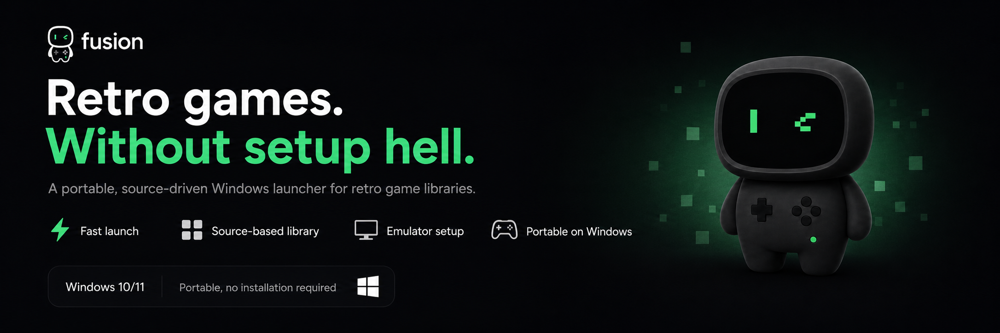

# Fusion (Fusion Launcher)

[Русская версия](README.ru.md)



**Status:** active Windows preview (`v0.4.0`) transitioning to the open **Fusion Source v1.0** architecture.
**Repository:** [blessdevhq/fusion-launcher](https://github.com/blessdevhq/fusion-launcher)

**Fusion** (distributed on Windows as **Fusion Launcher**) is an open platform for packaging, distributing, installing, updating, and running **layered software builds, modpacks, fan PC ports, recompilations, translations, and portable tool/AI bundles** on the open **Fusion Source v1.0** standard.

Built with Next.js 15, Tauri 2, Rust, and local-first SQLite storage.

## Modes on One Open Core (`fusion-source-core`)

Fusion Launcher, the built-in Fusion Creator v1 workflow, and the standalone CLI run on the same open Rust engine (`src-tauri/src/fusion_source/`, extracting to the `fusion-source-core` crate):

- **Fusion Launcher** *(Windows preview)*: connect direct HTTPS or local Sources, install layered packages with immutable BLAKE3 CAS deduplication, guided `Easy Setup`, manual local save snapshots, keep user saves/data isolated outside replaceable workspace snapshots, approve critical executables by exact BLAKE3 hash, and roll back cleanly between versions.
- **Fusion Creator v1** *(built-in author preview)*: create portable or layered package projects (`ProgramDescriptor 1.0`, `GameManifest 1.1` Source-relative mirrors), configure profiles and local SDL GameController bindings (`CreatorDeviceDialog` with pre-launch SDL release barrier), build Ed25519-signed releases, run isolated clean-install checks (`CreatorVerifyPanel`), export allowlisted artifacts, and verify live HTTPS mirrors (`CreatorReleasePanel`).
- **Fusion Studio** *(Stage 6 evolution)*: unifies built-in author workflows as a clean GUI over the extracted `fusion-source-core` crate and unified CLI (`fusion init / pack / test / publish`).

**Initial focus:** empowering creators of fan builds, PC ports, recompilations, translations, and modpacks layered non-destructively over users' existing games (Steam, GOG, Epic, or user-owned dumps), while keeping the underlying protocol completely domain-neutral for portable apps and AI toolkits.

## Core Capabilities (Fusion Source v1.0)

- **Layered, non-destructive workspaces:** immutable read-only BLAKE3 Content-Addressed Store (CAS) paired with hardlink projection, private writable copies (`writable_copy_paths`), config templates (`TOML`/`INI`/`JSON`), and non-destructive local base discovery for Steam, GOG, Epic, or manual folders without modifying original files.
- **Zero vendor lock-in:** authors choose where to host files — static HTTPS, GitHub Releases, mirrors, local directories, or BitTorrent (via the libtorrent sidecar) work as first-class transports with no central monopoly registry.
- **Cryptographic verification & explicit trust:** Ed25519-signed source indexes with pinned public keys, raw-byte manifest BLAKE3 verification, explicit per-binary BLAKE3 trust approvals (`critical_files`), and opt-in sanitized crash previews.
- **Isolated persistence & atomic rollback:** user saves and runtime data live outside versioned workspace snapshots, survive updates, and never get overwritten when rolling back binaries.
- **Forward-compatible evolution:** `capabilities` + `fallback` negotiation and `SchemaUpcaster` allow new features without breaking existing Sources.

## Current Status & Roadmap

`v0.4.0` is a transition release where the **Fusion Source** engine (`src-tauri/src/fusion_source/`, `fusion-packer`, `fusion-local`) and the built-in **Fusion Creator v1** author flow (`src-tauri/src/fusion_creator/`) are live and running alongside the legacy retro-catalog UI. Development follows a 6-stage roadmap:

1. **Stage 1:** Extract `fusion-source-core` into a Cargo workspace crate + finalize domain-neutral `v1.0` contracts (`PackageManifest`, `package_id`, `QualifiedPackageId`, `data_paths`, optional `metadata`).
2. **Stage 2:** Audit technical dependencies and completely remove the legacy retro-catalog/emulator-profile engine and duplicate UI/stores.
3. **Stage 3:** Complete core lifecycle workflows (`Save / Data Restore`, `Easy Setup`, resilient install/update/rollback/error recovery).
4. **Stage 4:** Unified CLI (`fusion init`, `fusion pack`, `fusion test`, `fusion publish`) on top of `fusion-source-core`.
5. **Stage 5:** Ship three open reference Sources (portable non-game/AI tool → modpack over Steam/GOG/Epic → fan PC port/recompilation).
6. **Stage 6:** Evolve built-in **Fusion Creator v1** into **Fusion Studio** over the extracted shared core and unified CLI.

## Legal & Content Model

Fusion is content-neutral open infrastructure. The Fusion project, repository, and official releases **does not host**, curate, or distribute **commercial ROMs**, games, **BIOS** files, **firmware**, **keys**, or third-party payloads (`public/demo-content/fusion-launcher-smoke.nes` is a first-party smoke-test image covered in `public/demo-content/LICENSE.txt`).

- **Users are responsible** for the Sources they connect and the local files they supply.
- By protocol invariant, `Bios`, `Firmware`, and `Keys` layers must always remain `user_provided` and can never be distributed as remote source payloads.
- Fusion is not affiliated with game publishers, console manufacturers, or third-party runtime projects.

## Documentation & Authoring

- [Fusion Source Standard v1.0](docs/fusion-source-standard-v1.md) — wire contracts, BLAKE3 CAS invariants, capability negotiation, persistence, and process supervision.
- [Fusion Creator v1 Guide](docs/fusion-creator-guide.md) — built-in authoring (`Base -> Verification -> Release`), `GameManifest 1.1` export, Verify HTTPS, and SDL input profiles.
- [Fusion Packer CLI](docs/fusion-packer.md) — authoring, inspecting, building, and Ed25519-signing Sources (`fusion-packer`).
- [Fusion Local Host](docs/fusion-local.md) — running offline/local Fusion Sources (`fusion-local`).
- [MVP Windows install checklist](docs/mvp-windows-install.md) & [Release checklist](docs/release-checklist.md) — installation and release verification notes.

*(Transitional legacy v3 source-library guides remain in `docs/` until Legacy removal in Stage 2.)*

## Development

Prerequisites:

- Node.js 22
- Rust stable
- Windows build tools for Tauri desktop builds

Install dependencies:

```powershell
npm ci
```

Run checks and build:

```powershell
npm run check
npm run qa
npm run dev
npm run tauri:build
```

Build standalone Fusion Source CLI tools:

```powershell
cargo build --manifest-path src-tauri/Cargo.toml --bin fusion-packer --bin fusion-local
```

## Release

The Windows release workflow runs on tags matching `vX.Y.Z` and builds the NSIS installer, updater zip/signature, and `latest.json`. Release builds require `TAURI_SIGNING_PRIVATE_KEY` (and `TAURI_SIGNING_PRIVATE_KEY_PASSWORD` if encrypted).

Run the local Windows release smoke gate:

```powershell
npm run mvp:release:windows
```

## License

Fusion source code is licensed under the GNU General Public License v3.0 or later. See [LICENSE](LICENSE).

First-party demo smoke-test content is covered separately in `public/demo-content/LICENSE.txt`.
