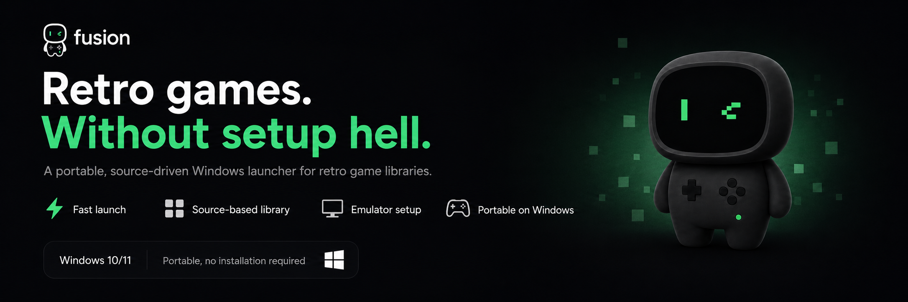

# Fusion (Fusion Launcher)

[English version](README.md)



**Статус:** активное preview для Windows (`v0.4.0`), переход к открытому стандарту **Fusion Source v1.0**.
**Репозиторий:** [blessdevhq/fusion-launcher](https://github.com/blessdevhq/fusion-launcher)

**Fusion** (распространяется на Windows как **Fusion Launcher**) — это открытая платформа для упаковки, распространения, установки, обновления и запуска **слоёных сборок, модпаков, фанатских PC-портов, рекомпиляций, переводов и портативных инструментальных/AI-сборок** на базе открытого стандарта **Fusion Source v1.0**.

Проект построен на Next.js 15, Tauri 2, Rust и локальном хранилище SQLite.

## Режимы работы на одном открытом ядре (`fusion-source-core`)

Fusion Launcher, встроенный режим автора Fusion Creator v1 и CLI работают поверх единого открытого движка на Rust (`src-tauri/src/fusion_source/`, выделяется в crate `fusion-source-core`):

- **Fusion Launcher** *(preview для Windows)*: подключение прямых HTTPS или локальных Sources, установка слоёных сборок с дедупликацией через неизменяемый BLAKE3 CAS, пошаговый `Easy Setup`, ручные снимки сохранений, хранение пользовательских данных отдельно от сменных версий сборки, явное подтверждение доверия к исполняемым файлам по точному BLAKE3-хешу и чистый откат версий.
- **Fusion Creator v1** *(встроенный preview-режим автора)*: создание переносимых и слоёных проектов (`ProgramDescriptor 1.0`, `GameManifest 1.1` с зеркалами от корня Source), профили сборки/управления и локальная настройка SDL GameController (`CreatorDeviceDialog` с предзапусковым SDL-барьером), сборка Ed25519-подписанных выпусков, изолированная чистая проверка (`CreatorVerifyPanel`), allowlist-экспорт и проверка живого HTTPS (`CreatorReleasePanel`).
- **Fusion Studio** *(развитие на Этапе 6)*: объединяет встроенные авторские сценарии как строгий GUI поверх выделенного `fusion-source-core` и единого CLI (`fusion init / pack / test / publish`).

**Стартовый фокус:** авторы фанатских сборок, PC-портов, рекомпиляций, переводов и модпаков поверх уже имеющихся игр пользователя (Steam, GOG, Epic или собственных дампов), при этом сам протокол и ядро изначально доменно-нейтральны и подходят также для портативного софта и AI-сборок.

## Ключевые возможности (Fusion Source v1.0)

- **Слоёная сборка рабочего каталога без порчи оригиналов:** неизменяемое хранилище BLAKE3 CAS, проекция неизменяемых файлов через hardlink, отдельные перезаписываемые копии (`writable_copy_paths`), шаблоны конфигов (`TOML`/`INI`/`JSON`) и поиск базовой установки в Steam, GOG, Epic или указанной папке без изменения оригинальных файлов.
- **Zero vendor lock-in (без привязки к хостингу):** автор сам решает, где размещать файлы — статический HTTPS, GitHub Releases, зеркала, локальные папки и BitTorrent (через libtorrent sidecar) работают как равноправные транспорты без центрального монопольного каталога.
- **Криптографическая проверка и явное доверие:** индексы Sources, подписанные Ed25519 с привязанным (pinned) публичным ключом, проверка сырых байтов манифеста по BLAKE3, явное одобрение каждого исполняемого файла по хешу (`critical_files`) и санитизированные отчёты о сбоях с просмотром перед отправкой.
- **Изоляция пользовательских данных и атомарный откат:** сохранения и пользовательские данные живут вне версионируемых снимков сборки, сохраняются при обновлениях и не затираются при откате бинарников.
- **Эволюция без поломки сборок:** механизм `capabilities` + `fallback` и `SchemaUpcaster` позволяют развивать протокол без ломки существующих Sources.

## Текущий статус и дорожная карта

`v0.4.0` — переходная сборка: движок **Fusion Source** (`src-tauri/src/fusion_source/`, `fusion-packer`, `fusion-local`) и встроенный цикл автора **Fusion Creator v1** (`src-tauri/src/fusion_creator/`) уже работают в приложении параллельно со старым ретро-каталогом. Дальнейшее развитие идёт по 6-этапному плану:

1. **Этап 1:** Выделение `fusion-source-core` в Cargo workspace + доменно-нейтральный контракт `v1.0` (`PackageManifest`, `package_id`, `QualifiedPackageId`, `data_paths`, опциональные метаданные).
2. **Этап 2:** Аудит технических зависимостей Legacy и полное удаление старого ретро-движка и дублирующих экранов/сторов.
3. **Этап 3:** Полнота ядра (`Save / Data Restore`, `Easy Setup`, надёжный цикл install / update / rollback / error recovery).
4. **Этап 4:** Единый CLI (`fusion init`, `fusion pack`, `fusion test`, `fusion publish`) поверх `fusion-source-core`.
5. **Этап 5:** Три эталонных открытых Source (портативный не-игровой инструмент / AI-сборка → модпак поверх Steam/GOG/Epic → фанатский PC-порт / рекомпиляция).
6. **Этап 6:** Развитие встроенного **Fusion Creator v1** в **Fusion Studio** поверх общего выделенного ядра и единого CLI.

## Юридическая и контентная модель

Fusion — нейтральная открытая инфраструктура. Проект, репозиторий и официальные релизы Fusion **не хостит**, не курирует и не распространяет коммерческие игры, ROM, **BIOS**, прошивки или ключи (файл `public/demo-content/fusion-launcher-smoke.nes` — собственный тестовый образ под лицензией `public/demo-content/LICENSE.txt`).

- **Пользователь сам отвечает** за подключаемые Sources и предоставляемые локальные файлы.
- На уровне валидатора протокола слои типа `Bios`, `Firmware` и `Keys` обязаны быть исключительно `user_provided` и не могут распространяться как удалённые файлы источника.
- Fusion не аффилирован с издателями игр, производителями консолей или сторонними проектами сред исполнения.

## Документация

- [Fusion Source Standard v1.0](docs/fusion-source-standard-v1.md) — формат контракта, инварианты BLAKE3 CAS, согласование возможностей, изоляция данных и супервизия процессов.
- [Руководство Fusion Creator v1](docs/fusion-creator-guide.md) — встроенный цикл автора (`Основа -> Проверка -> Выпуск`), экспорт `GameManifest 1.1`, Verify HTTPS и SDL-профили.
- [Fusion Packer CLI](docs/fusion-packer.md) — сборка, инспекция и Ed25519-подпись Sources (`fusion-packer`).
- [Fusion Local Host](docs/fusion-local.md) — локальный запуск Fusion Sources без сети (`fusion-local`).
- [Чек-лист установки на Windows](docs/mvp-windows-install.md) и [Чек-лист релиза](docs/release-checklist.md).

*(Устаревшая документация по legacy v3 source-libraries сохраняется в `docs/` временно до удаления Legacy на Этапе 2.)*

## Разработка

Требования:

- Node.js 22
- Rust stable
- Windows build tools для сборки desktop-приложения Tauri

Установка зависимостей:

```powershell
npm ci
```

Проверки и сборка:

```powershell
npm run check
npm run qa
npm run dev
npm run tauri:build
```

Сборка автономных CLI-инструментов Fusion Source:

```powershell
cargo build --manifest-path src-tauri/Cargo.toml --bin fusion-packer --bin fusion-local
```

## Релиз

Windows release workflow запускается на тегах вида `vX.Y.Z` и собирает NSIS-установщик, updater zip/подпись и `latest.json`. Для релизных сборок требуется `TAURI_SIGNING_PRIVATE_KEY` (и `TAURI_SIGNING_PRIVATE_KEY_PASSWORD`, если ключ зашифрован).

Локальный Windows release smoke gate:

```powershell
npm run mvp:release:windows
```

## Лицензия

Исходный код Fusion распространяется по GNU General Public License v3.0 или новее. См. [LICENSE](LICENSE).

Тестовый демо-образ покрыт отдельно в `public/demo-content/LICENSE.txt`.
